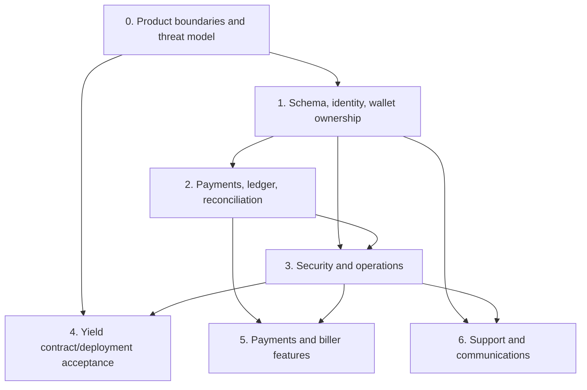

# Aero Engineering Roadmap

**M1B status addendum (2026-10-22):** The Fuji-only closed-signup identity foundation is implemented in source. The additive migration has not been applied to Neon, database integration tests have not run, and no production readiness is implied. See `AERO_M1B_IMPLEMENTATION_REPORT.md`.

The sequence below separates foundational infrastructure from consumer product features. Order matters: build identity, data integrity, authorization, and observability before adding biller or real-yield integrations.

## Milestone 0 — Define product boundaries and release claims

**Type:** Foundational product/security baseline  
**Depends on:** None

### Work

- Mark the current experience as a Fuji testnet sandbox and clearly distinguish tUSDC, simulated card settlement, mock yield, and live protocol claims.
- Decide which surfaces are intended for testnet, beta, and production; document supported assets, chains, wallet providers, and user recovery expectations.
- Define threat model and trust boundaries for user wallet, Aero backend, admin, contract owner, RPC/indexer, email provider, and any future bill/yield provider.

### Acceptance criteria

- User-facing claims match the tested implementation and identify simulated flows.
- Product and security owners sign off on a threat model and data classification.
- No real-value flow is enabled by an environment/configuration toggle without an explicit release gate.

### Test requirements

- Review copy and config combinations for testnet/production labels.
- Add a release checklist test that rejects production configuration pointing at mock token/vault/bank/router addresses.

## Milestone 1 — Schema, identity, and wallet ownership

**Type:** Foundational infrastructure  
**Depends on:** Milestone 0

### Work

- Introduce versioned database migrations and a supported shared database; remove the local file fallback from deployed environments.
- Model stable `users`, `wallets`, wallet verification challenges, sessions, and account lifecycle state. Decide whether username is on-chain canonical, mirrored, or independently reserved.
- Add cryptographic wallet ownership proof for account linking (nonce, chain/domain binding, expiry, one-time consumption), and separate sign-in/session authorization from payment transaction signing.
- Define multi-wallet, wallet-change, recovery, revocation, deletion, and user support identity policies.
- Add staff identities and roles before expanding admin operations.

### Acceptance criteria

- Each consumer has a stable internal ID; verified wallet addresses are unique and traceable to an account.
- Link challenges are expiring, nonce-bound, replay-protected, and verified server-side.
- Session expiry/revocation and account recovery work across devices.
- DB constraints and migrations can build a clean database and upgrade a prior version without data loss.

### Test requirements

- Migration up/down or forward-only upgrade tests, unique/foreign-key constraints, concurrent wallet-link tests, signature replay/domain/expiry tests, session expiry and revocation tests, and account deletion/retention tests.

## Milestone 2 — Payment records, ledger, and chain reconciliation

**Type:** Foundational financial infrastructure  
**Depends on:** Milestone 1

### Work

- Define payment intent and immutable transaction/event models, with internal user IDs and wallet IDs, chain ID, token address, amount units, recipient resolution, memo, tx hash, log index, and timestamps.
- Define explicit states: created, awaiting signature, submitted, confirming, confirmed/finalized, failed, replaced, reverted, and reorged.
- Add idempotency and uniqueness rules for client request keys and `(chainId, txHash, logIndex)` ingestion.
- Build an event indexer/reconciliation job with bounded reorg handling, retry/backoff, dead-letter visibility, and source-of-truth policy.
- Keep the browser receipt as a view of persisted/indexed state, not the only durable record.
- Remove or narrow blanket unlimited approvals and provide allowance/revoke UX.

### Acceptance criteria

- Every successful on-chain payment can be reconstructed and linked to an account/wallet, and every submitted payment has a durable terminal or actionable state.
- Duplicate webhooks, RPC retries, browser retries, and reorg replay do not double-count a payment.
- Reconciliation identifies and alerts on missing/orphaned/contradictory records.
- History is complete across pagination/device changes and indicates confirmation/finality.

### Test requirements

- State-machine tests for success, revert, dropped/replaced tx, RPC timeout, duplicate event, reorg, and partial service outage; integration tests with local chain and DB; indexer replay tests.

## Milestone 3 — Operational security and production gates

**Type:** Foundational security/operations  
**Depends on:** Milestones 1–2

### Work

- Replace shared-password deterministic admin cookie with managed identity or revocable server sessions and role-based authorization.
- Require configured secrets at production startup; establish secret manager/rotation policy and canonical origin allowlist.
- Move rate limits to shared edge/storage; validate proxy IP trust configuration.
- Add structured redacted logs, error reporting, metrics, alerting, transaction/indexer health dashboards, and audit events for privileged actions.
- Add CI for lint, typecheck, build, migration checks, contract tests, dependency audit, and browser tests. Review dependency tree and remediate advisories without blind breaking upgrades.
- Establish backup/restore, data retention, incident, key custody, and deployment rollback procedures.

### Acceptance criteria

- All privileged operations identify actor, time, action, and result in append-only logs.
- Sessions can be revoked immediately and production fails closed on missing required secrets.
- Alerts cover failed email/DB, RPC/indexer lag, transaction failures, and unusual admin/contract events.
- CI blocks release on failing quality/security gates; deployment has staged rollback and verified artifact provenance.

### Test requirements

- Auth/role matrix, CSRF/session replay, rate-limit concurrency and multi-instance tests, secret-missing startup test, alert delivery drills, restore exercise, dependency scan and build validation.

## Milestone 4 — Yield contract and deployment acceptance

**Type:** Foundational financial protocol integration  
**Depends on:** Milestone 0 threat model; may proceed in parallel with Milestones 1–3 only on isolated test deployments. Real value requires Milestones 1–3 release gates.

### Work

- Freeze B2.1.1 source and exact build inputs; run the full Foundry suite and adversarial/property tests from a clean environment.
- Resolve remaining adapter-withdraw share-delta invariant and formally specify rounding/value bounds for deposits and withdrawals.
- Test against a current fork of the specific supported Benqi market and token; validate market identity, pause state, decimals, rate units, exchange-rate accrual, and liquidity failures.
- Add withdrawal reserve/queue or formally accept and disclose the all-or-nothing liquidity model; add pause/emergency controls, timelock/multisig ownership, and monitoring.
- Add deployment chain-ID guard, deterministic manifest and bytecode verification; use staged deploy, post-deploy checks, and frontend allowlist/config gate.
- Keep Trader Joe, cross-chain/Warp, keepers, and optimizer out of scope until their actual adapters and operational services exist.

### Acceptance criteria

- Independent security review has no unresolved critical/high finding for the supported deployment.
- Fuzz/property tests cover inflation, rounding, losses, donations, malicious adapters, short returns, reentrancy boundaries, and liquidity failures.
- Deployment manifest binds chain, addresses, constructor args, compiler/source hashes, owner, adapter set, allocation weights, and verification links.
- Frontend disables actions unless address and bytecode match the approved deployment manifest; no mock contracts can pass the production gate.
- Exit behavior and liquidity limitations are measured and approved before any user deposit.

### Test requirements

- Foundry unit/fuzz/invariant tests, live-market fork tests pinned to block and market, deployment-script dry run and chain-ID negative test, bytecode verification, adapter failure simulations, and frontend integration tests against both valid and invalid deployment configurations.

## Milestone 5 — Real payment and biller product features

**Type:** Product features  
**Depends on:** Milestones 1–3; bill payments additionally depend on provider contracts and legal/operational approval.

### Work

- Build payment request/receipt screens over the durable payment state model.
- Integrate a selected biller/provider behind an adapter interface with authenticated requests/webhooks, price/fee quote, account validation, execution, receipt, reversals, retry/idempotency, and support escalation.
- Add real fiat on-ramp only through an approved provider with KYC/AML and jurisdictional controls as required; retire AeroBank sandbox outside testnet.

### Acceptance criteria

- Provider execution status is cryptographically/authentically verified and linked to a user and ledger record.
- Duplicate/retried requests cannot create duplicate charges; failure and reversal states are visible and supported.
- End-to-end successful and failed bill payment can be reconciled between provider, Aero records, and chain where applicable.

### Test requirements

- Provider sandbox contract tests, webhook signature/replay tests, timeout/retry/idempotency tests, partial/duplicate settlement tests, reversal/dispute scenarios, and end-to-end browser tests.

## Milestone 6 — Support, communications, and account operations

**Type:** Product/operations features  
**Depends on:** Milestones 1–3; support may begin after identity and role model exists.

### Work

- Add ticket, message, internal-note, assignment, status, attachment, and audit models linked to user/payment records.
- Add authenticated intake and inbound email provider integration; persist delivery status and retries for outbound email/notifications.
- Add notification preferences and account-scoped delivery channels.

### Acceptance criteria

- Support agent can find a user/payment with least-privilege access, see transaction evidence, track ownership/status, and record outcome.
- User can view and reply to a case across devices; internal notes are never exposed to the user.
- Email/webhook retries are idempotent and delivery failures are visible.

### Test requirements

- Role/visibility matrix, case lifecycle, attachment access control, email inbound authenticity, delivery retry, and notification preference tests.

## Dependency map

## Recommended first milestone

Start with **Milestone 0 followed by Milestone 1**, then begin Milestone 2. The current repo can demonstrate a wallet-to-wallet Fuji transfer, but it lacks the stable consumer identity and database invariants needed to add a trustworthy account model or financial ledger. In parallel, keep Milestone 4 strictly isolated to mock/fork test environments until the source, ownership, and deployment are independently accepted. Do not build a biller UI or represent mock yield as a production service ahead of these foundations.

