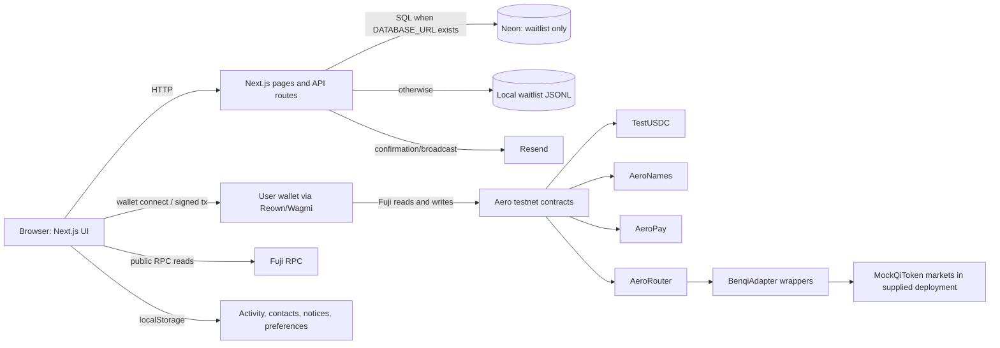

# Aero System Architecture and Product Readiness Audit

**Audit date:** 2026-10-21  
**Scope:** Local repository at `C:\Users\USER\Desktop\Aero`; source and repository configuration only. No contract deployment, transaction, database access, production-secret access, or application-code change was performed.  
**Snapshot note:** The working tree was already dirty when the audit began. It contains uncommitted B2.1.1 yield/router/frontend changes, test updates, and three prior yield review documents. This report audits the current working-tree source, including those changes; it does not attribute them to this audit or certify their deployment.

## Executive summary

Aero currently has two materially different products in one Next.js application:

1. A marketing site and an email-confirmed waitlist, backed optionally by Neon Postgres or a local JSONL file.
2. A wallet-connected Avalanche Fuji sandbox where the browser submits transactions directly through the connected wallet. The sandbox has working test-token transfers, an on-chain username registry, a payment contract, simulated buy-card settlement, and simulated yield contracts. It is not an authenticated, database-backed consumer finance account system.

The repository contains no user, wallet-link, payment, bill, yield-position, support, notification, or audit-record schema. No migrations or schema source were found. The only relational data model inferred from SQL is a `waitlist` table; its DDL, indexes, constraints, and database transaction policies are not present in the repository. No application server API persists consumer financial activity.

The current yield router source is substantially more complete than the older baseline report: it has virtual-share pricing, `minShares`, idle/donation accounting, router-owned adapter position valuation, deposit share-delta and value checks, withdrawal receipt checks, and a frontend deployment gate. Existing tests cover many of those cases. However, the implementation remains connected to owner-rate-controlled mock markets in the supplied integrated deployment script. There is no evidence in the repository establishing what addresses are currently deployed or that any live Benqi market has been integrated. Liquidity is synchronous and all-or-nothing; the design has no withdrawal queue, reserve, pause, or timelock.

The highest readiness risks are:

- Wallet connection is the only consumer identity mechanism. There are no user accounts, sessions, wallet-link proof flow, recovery, or server-side financial authorization layer.
- Payments and balances are on-chain, but no durable internal financial ledger, transaction state machine, idempotency layer, or reconciliation process exists. The history UI combines bounded on-chain reads and browser-local activity.
- “Bills” are predefined form-fill values that lead to ordinary USDC payments. No biller/provider integrations, verification, reversal, or dispute flow exists.
- Yield and buy-card flows are demos: AeroVault accrual is synthetic, the router's supplied deployment uses mock QiToken markets, and AeroBank distributes pre-funded test USDC.
- The repo has no application CI, frontend test runner, migrations, or reproducible deployment manifest. `npm audit --omit=dev` reported seven high severity advisories in the installed dependency graph; applying the suggested forced fix would make a breaking shadcn upgrade.

**Recommended first implementation milestone:** establish the foundational account and financial-record model before broadening product features: define stable user and linked-wallet identities, a durable payment/transaction state machine with idempotency and chain reconciliation, and schema migrations with explicit invariants. Keep wallet signatures as transaction authorization; do not treat a connected wallet as an authenticated Aero account. Before any yield funding beyond controlled testnet, complete the separate contract deployment/security acceptance work described below.

## Existing architecture

### Stack and boundaries

- **Frontend and server runtime:** Next.js App Router 16.4.0, React 19.3.0, TypeScript. Routes live under `app/`; API route handlers cover waitlist and waitlist-admin operations only. Middleware rewrites `testnet.useaero.org` routes to `/testnet` (`middleware.ts`).
- **Wallet/client chain integration:** Reown AppKit, Wagmi, TanStack Query, and Viem. The testnet UI calls contracts through the connected wallet and reads Fuji through Viem; there is no application transaction-signing service or financial API backend.
- **Persistence and email:** `@neondatabase/serverless` is optional behind `DATABASE_URL`; without it, waitlist handlers use a local JSONL file. Resend sends confirmation, team notification, and broadcast emails.
- **Contracts:** Solidity 0.8.24, Foundry, OpenZeppelin contracts. Source includes TestUSDC, AeroNames, AeroPay, AeroVault (mock), AeroBank (sandbox), AeroRouter, BenqiAdapter, and MockQiToken.
- **Operations:** `package.json` provides `dev`, `build`, `start`, `lint`, `format`, and `typecheck`. `contracts/foundry.toml` configures Solidity 0.8.24/Cancun and a Fuji RPC endpoint. No `.github` workflow, Docker/deployment manifest, migration directory, or app-level automated test configuration was found.

### Entry points and data flows



There is a separate direct `AeroVault` demo path when a router is not configured. Neither backend persistence nor on-chain contracts currently create a canonical joined consumer-account/payment record.

### Consumer-facing capabilities by status

| Capability | Status from source evidence |
|---|---|
| Wallet connection | Implemented for Fuji through Reown/Wagmi when project configuration exists. This connects an external wallet; it does not create or authenticate an Aero account. |
| Test USDC | Implemented test token with faucet; not real USDC or monetary value. |
| Username registration/resolution | Implemented on-chain in AeroNames. One active username per address; release/re-registration allowed. |
| Send to address/username | Implemented as wallet-signed Fuji token transfer, using AeroPay when configured or direct token transfer fallback. Not a production payments service. |
| Request payment | UI creates a payment link/prefill; it is not a request ledger or enforceable receivable. |
| Bill payment | Demo presets fill recipient, amount, and memo; actual action is an ordinary USDC transfer. |
| Buy with card | Simulated card interaction followed by real Fuji transfer of pre-funded test tokens from AeroBank. No card processor or fiat settlement. |
| AeroVault yield | Implemented synthetic index/rate accrual funded by finite token inventory. Not protocol yield. |
| AeroRouter | Current source implements portfolio accounting over adapters. The integrated script deploys MockQiToken markets and labels them as Benqi/Trader Joe mock markets. No verified live protocol connection is established. |
| Support | Static contact/help content only; no ticket or conversation system found. |
| Waitlist | Implemented API, optional Postgres/file persistence, confirmation links, referrals, admin operations, and Resend integration. This is the only account-like stored data. |

## Identity and authentication

- The testnet `LoginView` initiates wallet connection. UI state comes from `useAccount`; the app remembers a last address in browser local storage. No OAuth/password/passkey consumer registration, server session, internal user ID, profile, or account table was found.
- A wallet can sign the transactions it initiates. There is no standalone cryptographic wallet ownership challenge for linking an address to a separate account, no supported multi-wallet account linkage, and no application-side recovery or account deletion flow.
- Account username ownership is enforced on-chain by AeroNames. Handles are not tied to an internal Aero user record and may be released or changed.
- Consumer financial authorization is enforced by the contracts and connected wallet for transfers. There are no authenticated consumer API routes to authorize against an Aero user identity.
- A separate single-password admin area exists for waitlist operations. `aero_admin` is HTTP-only, SameSite=Lax, Secure in production, and browser-expiring after seven days. Its value is a deterministic HMAC of the configured admin password with no embedded expiry or server-side revocation state; logout deletes the browser cookie but cannot revoke a copied value. The in-memory login throttle is per process/instance.

## Database and data model

Repository search found no migration/schema/ORM files and no DDL. Waitlist code issues parameterized SQL against a table named `waitlist`, assuming that table already exists. `DATABASE_URL` enables that path; otherwise the code appends JSONL records (and the admin file path reads/rewrites that file). The repository therefore cannot establish the actual production database schema, constraints, indexes, backups, isolation level, or transaction boundaries.

| Requested entity | Found in repo? | Notes |
|---|---|---|
| Users / profiles | No | Waitlist rows are not consumer accounts. |
| Wallets / linked wallets | No | Addresses exist in browser state/on-chain events only. |
| Usernames | On-chain only | AeroNames registry; not a DB entity or unique link to internal user. |
| Payments / transactions | No DB model | AeroPay emits `Paid`; token/contracts emit events. Browser keeps recent activity in local storage; chain activity queries are bounded. |
| Bills | No | UI constants only. |
| Yield positions / deposits / withdrawals | No DB model | Contract shares/events and browser reads only. |
| Support / communications | No | Email is for waitlist/admin broadcasts; no user-ticket relation or thread model. |
| Notifications | Browser-local only | Local storage notification list/seen hashes; no server push or durable account notification state. |
| Audit records | No | No application audit-event table or admin action history found. |
| Waitlist | Assumed SQL table and local JSONL fallback | Code uses email, username, referral_code, referred_by, confirmed, confirmed_at, id, created_at. Exact DDL and rules are absent. |

The SQL path inserts a waitlist row in one statement, then counts position/referrals in separate statements; the file fallback is append-oriented and best-effort. There is no transaction around signup plus notification delivery, and email failure does not roll back the signup. Uniqueness and race behavior depend on missing database constraints. Duplicate-email lookup and insert are not shown as one atomic operation. The local fallback is not suitable as shared durable storage across serverless instances.

## Financial accounting and transaction integrity

- On-chain token balances and contract share balances are the authoritative balances in the demo. No double-entry ledger, journal, reserved balance, or reconstructable internal transaction state exists.
- `AeroRouter.totalAssets()` currently sums router-held asset tokens and assets attributable to the router's own adapter shares. Router deposits measure token deltas and adapter share deltas; the router checks reported/minted adapter shares and a rounding-bounded value increase. Withdrawals use idle assets first, measure actual returned assets, and revert atomically if an adapter fails or returns short. These are meaningful source-level protections in the current working tree.
- Router withdrawals remain synchronous, pro-rata, and all-or-nothing. Any unavailable/failed slot can make the whole requested withdrawal revert; there is no queue, partial withdrawal, reserve floor, or asynchronous claim state.
- AeroVault's index grows over time from an owner-configured rate, independently of yield generated by underlying assets. Its deployment seeds a finite amount of tUSDC as subsidy; accrued claims can exceed funded inventory.
- Frontend transaction submission waits for a chain receipt via Wagmi. There is no durable internal pending/confirmed/reverted state, idempotency key, retry worker, deduplication service, chain reorg policy, or reconciliation job. A browser disconnect/reload may lose presentation state but not the on-chain transaction.
- On-chain activity reads cover a fixed recent block window and currently focus on token transfers and AeroVault events; they do not provide a complete indexed history for router events. Locally generated activity and notices are stored in local storage. Thus the app's displayed history is not a guaranteed full financial statement.

## Payments

1. The user types a username or address; frontend reads resolve AeroNames and validates/parses the amount.
2. If AeroPay is configured, UI first asks for a USDC approval (currently unlimited approval), then calls `payUsername` or `pay`. Otherwise it calls the token's `transfer` directly.
3. `AeroPay` performs `transferFrom` and emits `Paid` with from/to/token/amount/memo/timestamp. Username resolution happens in the contract for handle payments.
4. Wagmi waits for transaction receipt. A successful browser flow creates a local receipt/activity entry; the durable evidence is the chain transaction/event.

There is no DB persistence, receipt service, payment intent, idempotency, retry workflow, confirmation webhook, dispute/reversal protocol, recipient identity assertion, or comprehensive history indexer. Direct-transfer fallback does not emit AeroPay's memo event. The connected wallet must hold the test asset and approve/submit the transaction.

## Yield infrastructure and B2.1.1 remediation status

### Actual implementation

- **AeroVault:** explicitly documented in source as a mock fixed-rate testnet vault. Its owner sets `ratePerSecond`; `accrue()` increases the share index mathematically. It does not interact with a lending market.
- **AeroRouter:** current source values idle assets and router-owned adapter shares, uses a virtual-asset/share offset and `minShares`, validates adapter configuration, enforces allocation invariants, uses measured balance deltas, and reverts on withdrawal shortfalls. It supports permissionless `rebalance()` to static owner-set targets; it does not select optimal markets or automatically run a keeper.
- **BenqiAdapter:** source wraps a QiToken-like interface and binds to a single router. Source implementation alone does not prove compatibility with a deployed/live Benqi market.
- **Integrated Fuji script:** `DeployMore.s.sol` deploys two `MockQiToken` markets and two `BenqiAdapter` wrappers, labels one market Joe, creates a 60/40 router, binds adapters, and checks owner/configuration/version. It is a mock stack; no Trader Joe-specific adapter is implemented.
- **Frontend gate:** router actions/read paths check Fuji bytecode, `deploymentVersion == 2111`, configured asset equality, nonzero bounded slot count, and `configurationValid()`. This fails closed when checks are not satisfied. The gate is runtime configuration validation, not a source verification or external security audit.

### B2.1.1 items checked against current source

| Previously identified item | Current source assessment |
|---|---|
| Donation-driven first depositor inflation | Addressed in current source by virtual assets/shares, orphaned-asset deposit block/recovery, and tests including classic and fuzz donation cases. This is source/test evidence, not an executed test or proof of all possible economic edge cases. |
| Router counts adapter shares | Addressed: `slotAssets()` converts `sharesOf(router)`; aggregate market balance is not directly counted as router assets. Adapter methods are router-only after one-time binding. |
| Adapter deposit share verification | Addressed in `_depositIntoSlot`: checks token spent, increase in router-held adapter shares, exact agreement with adapter-reported shares, and bounded value increase. Current test source includes non-minting, wrong-report, and value-shortfall adapters. |
| Frontend deployment gate | Addressed in current panel and router-dependent UI with bytecode/version/asset/slot/config checks. It checks a self-reported version constant and interface/configuration, not verified bytecode/source provenance. |
| Deployment preflight and adapter binding | Improved: integrated `DeployMore` creates adapters and router in one script, checks token code/6 decimals, owner, router config and version. Remaining: script does not assert `block.chainid == 43113`; `--rpc-url`/broadcast target is operator-selected, and there is no signed deployment manifest or verification artifact. Multi-transaction broadcast can partially execute if a later operation fails. |
| Share decimals | Addressed in current source for the intended convention: router mints normalized 18-decimal shares via `virtualShares`; BenqiAdapter reports underlying asset decimals and retains raw underlying-unit semantics. Tests assert both current router and adapter decimal behavior. |

### Remaining yield risks and limits

- No external audit, live-market/fork validation, verified deployment record, deployed-address manifest, or current deployment compatibility query was performed as part of this source-only audit. `.env.example` contains variable names but no deployment values; no production secrets or local secret files were read.
- Integrated router markets are mocks; “APY” is a simple annualized reported supply rate and mock rate is owner-controlled. It is not a guaranteed yield/APY result.
- Liquidity is not reserved or guaranteed; withdrawals can revert if any required adapter cannot redeem. No pause, timelock, emergency exit, queue, keeper, or monitoring/alert process is in the router.
- The owner can change weights and rebalance; trust assumptions, key custody, multisig, and deployed ownership are unknown.
- Router enforces exact adapter share minting on deposit and measures assets on withdrawal, but cannot establish that arbitrary owner-selected adapter code has honest conversion semantics. On withdrawal it does not explicitly assert the adapter share balance fell by exactly the requested shares; future adapter additions should be governed by a strict audited interface and adversarial tests.
- `configurationValid()` is a compatibility probe, not a security proof. Frontend version checks can be satisfied by any contract that returns matching selectors/values.
- Existing fork test source is guarded to return early unless chain ID is Avalanche mainnet (43114). It was not run against a fork during this audit; it cannot certify a live protocol connection from this review.

## Billing

The testnet UI defines a short list of bill-like items (for example rent/utilities) that fills recipient username, amount, and memo into the regular send form. The user then sends tUSDC through the same wallet transaction path as a peer payment. No biller API, provider authentication, account-number validation, quote/fee path, bill payment execution API, provider response verification, fulfillment status, receipt/reversal, retry/idempotency policy, or link to an internal account exists. These are demo shortcuts, not implemented bill payment categories in a financial integration sense.

## Support and communications readiness

- Resend is used for waitlist confirmation and optional team notification and for admin waitlist broadcasts.
- Static contact/help copy exists. No support-ticket model, user-to-ticket relationship, message threading, staff notes, assignment, ticket status, dispute handling, case attachment, or authenticated user support API was found.
- No Cloudflare email integration, inbound email parser, email event webhook, message delivery state model, or user notification service was found. `.env.example` documents Resend and waitlist settings only.
- Admin email broadcasts are a single-password waitlist operation; the implementation has basic input length checks and HTML escaping, but not a durable campaign record, per-recipient delivery tracking, or asynchronous job/retry system.

## Security and operations

- **Validation:** waitlist email/username/referral inputs are validated; SQL values use Neon tagged-template parameterization. Financial form validation is client-side plus contract checks. AeroPay itself checks nonzero recipient and memo length but accepts a caller-supplied token address and does not reject zero amount.
- **Rate limits:** small in-memory IP buckets cover waitlist/admin endpoints. State is not distributed and resets across serverless instances/cold starts. Forwarded IP headers are trusted as provided by the request environment.
- **Secrets:** `.env.example` names secrets but has no values. `.gitignore` excludes `.env*` except `.env.example`. `WAITLIST_SECRET` has a code fallback (`dev-only-waitlist-secret`); production must require a high-entropy configured secret rather than silently using that default. No secret values were read or reported.
- **Admin session:** HTTP-only/SameSite=Lax cookie is a deterministic password-derived HMAC, without server-side session storage, embedded expiration, rotation, or revocation. Browser max-age alone does not invalidate a copied token. Admin auth is a single shared password with no per-staff identity or audit trail.
- **Logging:** broadcast errors are logged to server console; no structured redaction policy, centralized observability, error reporting, alerting, or transaction monitoring was found. Waitlist emails are handled as personal data but there is no data retention/deletion audit trail beyond admin deletion.
- **Background/retry:** no worker, queue, cron, webhook processor, or durable retry path exists.
- **Dependencies:** `npm audit --omit=dev` completed with exit code 1 and reported **7 high severity vulnerabilities** in the dependency tree, including `braces` via `micromatch`/`fast-glob` and shadcn-related packages. npm's suggested `npm audit fix --force` would install a breaking shadcn version; no fix was applied. This is an advisory snapshot from the audit date, not proof of runtime exploitability.
- **On-chain admin:** router ownership is OpenZeppelin Ownable and direct; no multisig/timelock/pause is present in router source. AeroBank has owner sweep of sandbox inventory. Deployment key custody is not established.

## Testing, builds, deployment

- **Solidity tests:** Foundry suites exist for AeroRouter, BenqiAdapter, AeroVault, AeroNames, AeroPay, AeroBank, TestUSDC, and a guarded Benqi mainnet fork test. Current router tests include extensive accounting, inflation, adapter-failure, and liquidity scenarios. No test command was run in this audit.
- **Frontend tests:** no Jest/Vitest/Playwright/Cypress setup or application test files were found. No frontend behavior or browser flow was executed.
- **Commands available:** `npm run build`, `npm run lint`, `npm run typecheck`; in `contracts/`, Foundry supports `forge build` and `forge test`. These commands are defined/available, not asserted as passing by this audit.
- **CI/CD:** no repository GitHub Actions/workflow or deployment pipeline was found. No Docker, Wrangler, or equivalent deployment config was found. Host routing suggests separate marketing and testnet hostnames, but the actual hosting environment and production/testnet variable sets cannot be established from source.
- **Environment variables:** `.env.example` lists Resend, waitlist, Neon, admin, Reown, Fuji contract addresses, and a deployer test key. The current source expects configuration values to be supplied at runtime/build time. No actual values were read.
- **Deployment:** Foundry config defines Fuji. `Deploy.s.sol` deploys mock TestUSDC, mock AeroVault and AeroNames; `DeployMore.s.sol` deploys mock router stack. No mainnet deploy script or deployment manifest was found. No contract was deployed or queried.

## Repository evidence inspected

Primary source/configuration inspected:

- `package.json`, `package-lock.json`, `tsconfig.json`, `next.config.ts`, `middleware.ts`, `.env.example`, `.gitignore`, `README.md`, `contracts/foundry.toml`.
- `app/page.tsx`, `app/testnet/page.tsx`, `app/pay/[handle]/page.tsx`, `app/docs/page.tsx`, `app/admin/page.tsx`, and waitlist/admin API route handlers under `app/api/`.
- `components/testnet/providers.tsx`, `components/testnet/shell.tsx`, `components/testnet/views.tsx`, `components/testnet/terminal.tsx`, `components/testnet/buy-sheet.tsx`.
- `lib/db.ts`, `lib/waitlist.ts`, `lib/waitlist-store.ts`, `lib/waitlist-email.ts`, `lib/admin-auth.ts`, `lib/rate-limit.ts`, `lib/testnet.ts`, `lib/onchain-activity.ts`, `lib/testnet-activity.ts`, `lib/contacts.ts`, `lib/notifications.ts`, `lib/contracts/`.
- Contract source/interfaces in `contracts/src/`; deployment scripts in `contracts/script/`; tests in `contracts/test/`; `contracts/docs/AeroRouter.md`.
- Existing untracked yield review documents: `AERO_B2_1_INDEPENDENT_REVIEW.md`, `AERO_YIELD_BASELINE_AUDIT.md`, and `AERO_YIELD_REMEDIATION_REPORT.md`. They were cross-checked against current code; their claims were not accepted without current-source evidence.

## Audit commands and results

Commands were run from `C:\Users\USER\Desktop\Aero` unless stated otherwise. Read-only discovery commands included:

```powershell
Get-Location; git status --short; rg --files -g '!node_modules' -g '!\.next' | Select-Object -First 250
rg --files app lib contracts/src contracts/script contracts/test .github -g '!contracts/lib/**'
rg -n "CREATE TABLE|CREATE INDEX|ALTER TABLE|CREATE TYPE|sql`|sql\(|DATABASE_URL|TODO|mock|Mock|simulat|localStorage|session|cookie|authorization|rateLimit|rate-limit|fetch\(|writeContract|sendTransaction|waitForTransaction|useAccount|useConnect|signMessage|privateKey|DEPLOYER_KEY|process\.env|onchain|AeroRouter|BenqiAdapter|AeroVault|AeroNames|AeroPay|AeroBank|bill|yield|deposit|withdraw|payment|username|handle" app lib components contracts/src contracts/script contracts/test README.md contracts/docs .env.example -g '!lib/contracts/abi/**' -g '!contracts/test/**'
rg -n "CREATE TABLE|CREATE INDEX|ALTER TABLE|CREATE TYPE|waitlist \\(" --glob '!node_modules/**' --glob '!contracts/lib/**' .
rg -n "^#|^##|B2\\.1\\.1|inflation|adapter.share|deployment gate|preflight|decimal|Test Results|Finding|Severity" AERO_B2_1_INDEPENDENT_REVIEW.md AERO_YIELD_BASELINE_AUDIT.md AERO_YIELD_REMEDIATION_REPORT.md
rg --files -g '.github/**' -g '*migration*' -g '*schema*' -g '*prisma*' -g '*drizzle*' -g '*test*' -g '*spec*' -g 'Dockerfile*' -g 'vercel.json' -g 'wrangler*' -g 'fly.toml' -g '!node_modules/**' -g '!contracts/lib/**'
npm audit --omit=dev
```

Additional read-only commands used `Get-Content` on the manifests, environment example, backend/API handlers, frontend flow components, contract source/interfaces, deployment scripts, test files, Foundry config, and existing yield reviews; `Select-Object` extracted focused sections and `rg -n` located function/test symbols. `git diff --stat` and targeted `git diff -- ...` were used to inspect the pre-existing working-tree changes. The initial `git status --short` showed modified application/contract files and untracked yield reports/mocks; a later status snapshot after the audit-document writes showed only the three new audit documents and pre-existing `aero deployer.txt` untracked. This change in status occurred outside any source-edit action by this audit; no application file was intentionally edited. The file inventory showed no schema/migration or CI pipeline. `npm audit --omit=dev` exited 1 and reported seven high severity advisories. No build, typecheck, lint, unit test, fork test, deployment, chain query, database query, or live UI test was run.

## Questions repository evidence cannot answer

- What exact waitlist schema/indexes/constraints exist in the configured Neon database, and what backups/retention controls are in place?
- Which contract addresses are currently configured in deployment environments, who owns them, what code is deployed there, and do any correspond to current B2.1.1 source?
- Is the deployed Fuji router stack still mock-based, and are its adapters bound and funded? No deployment addresses were disclosed or queried.
- What production/testnet hosting, secrets policy, monitoring, CI/CD, incident response, key custody, and support staffing are in place?
- Are Resend delivery events, unsubscribe/suppression requirements, privacy/data deletion obligations, or bill provider agreements handled outside this repository?
- Has the current yield code been independently audited or tested against live Benqi markets after the working-tree modifications?

