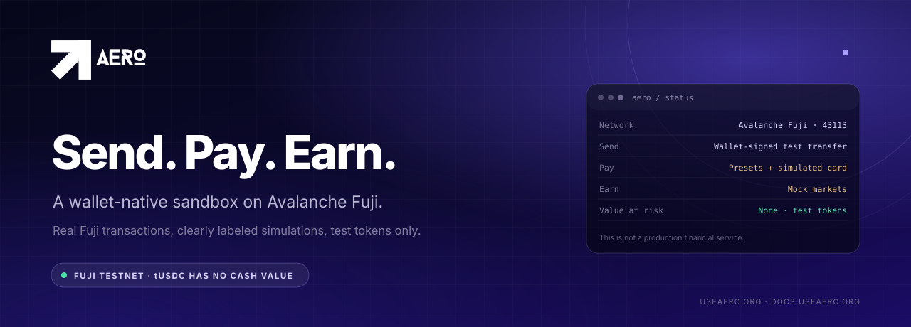
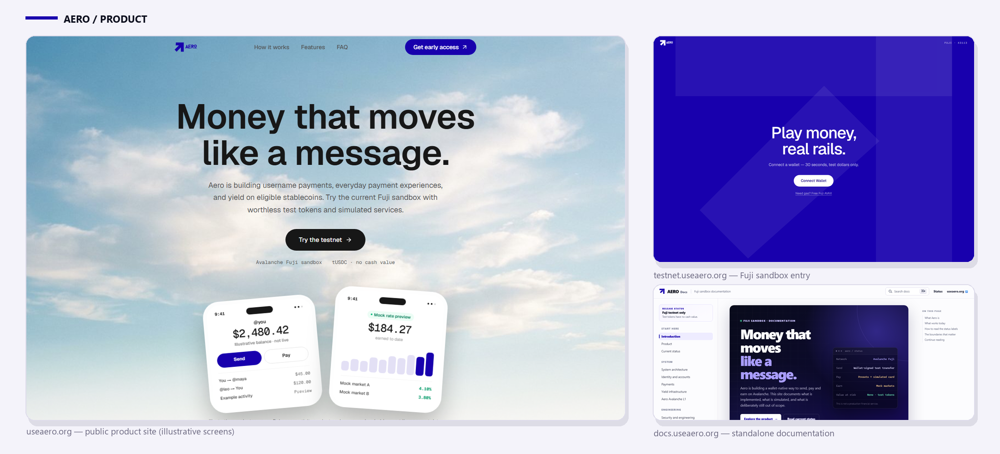
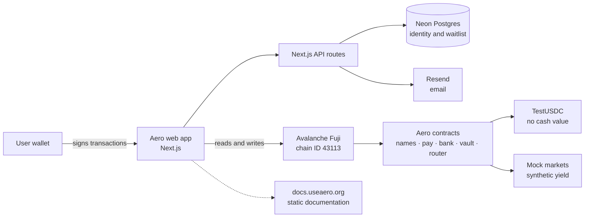

<p align="center">
  
</p>

<h1 align="center">Money that moves like a message.</h1>

<p align="center">
  A wallet-native product for <strong>sending</strong>, <strong>paying</strong> and <strong>earning</strong> on Avalanche.<br>
  Today it is an <strong>Avalanche Fuji testnet sandbox</strong>.
</p>

<p align="center">
  <a href="https://useaero.org"><strong>Website</strong></a> &nbsp;·&nbsp;
  <a href="https://docs.useaero.org"><strong>Documentation</strong></a> &nbsp;·&nbsp;
  <a href="https://testnet.useaero.org"><strong>Fuji sandbox</strong></a> &nbsp;·&nbsp;
  <a href="https://github.com/danielamodu/Aero"><strong>GitHub</strong></a>
</p>

Aero is a consumer payments product built around three verbs: **Send**, **Pay** and **Earn**. The long-term idea is simple — money should move with the ease of a message, without asking people to decode addresses, chains or protocol jargon.

The current product is real software with a deliberately narrow boundary. A connected wallet can claim test dollars, register a Fuji handle, send a memo-bearing payment, open a prefilled request, try bill-shaped and card-shaped flows, and inspect a portfolio backed by mock markets. Some of those paths settle a real Fuji transaction. Others are explicitly simulated. This repository contains the whole product: the Next.js app, the Foundry contracts, the identity foundation and the standalone documentation site.

> **Sandbox boundary:** tUSDC is a test token with no cash value. Aero does not custody real money, does not connect to a biller, card processor or live lending market, and is not production-ready.

## What works today

| Surface | Status | What is real |
|---|---|---|
| **Send** | **Implemented** · **Tested** · **Fuji testnet** | Handles resolve through the on-chain `AeroNames` registry. `AeroPay` carries a bounded memo in one wallet-signed transaction, with a direct token-transfer fallback. Activity is browser-local plus bounded on-chain reads. |
| **Pay** | **Partially implemented** · **Mock/demo** | Payment requests and bill presets prefill an ordinary tUSDC transfer. The card sheet is a simulated checkout backed by pre-funded `AeroBank` test inventory. No biller, card processor, fiat charge or enforceable receivable exists. |
| **Earn** | **Mock/demo** · **Partially implemented** | `AeroVault` is a synthetic rate/index mock. `AeroRouter` has real share accounting, target weights and measured adapter transfers, but the integrated deployment uses mock Qi markets. There is no live Benqi or Trader Joe position. |
| **Identity** | **Implemented** · **Blocked** | Fuji EOA SIWE, opaque sessions, CSRF binding, origin checks and layered rate limits exist in source. Account creation is closed and the Neon runtime provisioning/migration is not applied. |
| **Aero L1 / ICM** | **Planned** · **Not supported** | A separate workstream. There is no verified chain, consumer contract deployment or cross-chain payment path. |
| **Production** | **Blocked** | No approved production asset, chain, deployment manifest, independent audit or non-mock provider integration. |

Recorded test evidence covers **67** Foundry contract tests, **40** identity tests against disposable PostgreSQL and live Fuji RPC, **10** release-gate tests and a Fuji-configured Next.js build. Tested is not the same as deployed, audited or safe for real value.

## Product tour

<p align="center">
  
</p>

<p align="center"><sub>Real captures from the running application. The product screens inside the marketing site are labeled illustrative; the sandbox requires a connected wallet.</sub></p>

The public site explains the direction. The Fuji sandbox is where the wallet, handle, payment and portfolio paths are exercised. Payment is signed in the user's wallet; Aero never holds a key that can move a user's tokens.

## How it fits together



The important boundary is vertical: the browser talks to contracts **through the user's wallet**. There is no Aero transaction-signing service, no custodial key and no server-side transfer authorization. The identity API adds accounts and sessions, but a session never authorizes a token transfer.

- The marketing site, sandbox and API routes are one Next.js application.
- The contracts are a separate Foundry project deployed per environment on Fuji.
- Addresses are read from `NEXT_PUBLIC_*` variables. `lib/fuji-router-manifest.ts` is intentionally empty, so no router address is treated as a trusted deployment.
- The documentation site is a separate static application built from `docs/`, not a set of main-app routes.

## Status

| Area | Status | Evidence and boundary |
|---|---|---|
| Contract suite | **Tested** | 67 Foundry tests passed after the deployment preflight fix. Fork tests were not run against a live market. |
| Release gate | **Tested** | 10 release-gate tests passed. `prebuild` fails closed on missing or mismatched environment classifications; the production allowlist is empty. |
| Deployment | **Blocked** | The B2.2 exercise simulated nine transactions and broadcast nothing. Predicted addresses are not deployment identities. |
| Live yield | **Blocked** | No independent audit, live-market acceptance, liquidity model or approved production asset. |
| Durable payments | **Planned** | There is no internal payment ledger, idempotency key or reconciliation service. A transaction hash alone does not make a payment final or reconciled. |
| Biller / card | **Planned** | No provider contract, settlement model, reversal path or dispute process. |
| Production | **Blocked** | No approved chain or asset, verified runtime bytecode, monitoring, incident runbook or audit. |

The full matrix, including every partial and unsupported path, lives at **[docs.useaero.org/status](https://docs.useaero.org/status/)**.

## Stack

| Layer | Technology |
|---|---|
| Application | Next.js `16.4`, React `19.3`, TypeScript 5, Tailwind CSS 4, Motion |
| Wallets | Reown AppKit, Wagmi, Viem |
| Contracts | Solidity `0.8.24`, Foundry, OpenZeppelin |
| Data and email | Neon Postgres (`@neondatabase/serverless`), Resend |
| Documentation | Standalone Node static generator, Marked, highlight.js, locally vendored Mermaid |
| Checks | Foundry, `node:test`, ESLint, `tsc --noEmit` |

There is no GitHub Actions workflow in this repository yet. Checks are run manually; do not assume a green badge that is not there.

## Repository structure

```text
.
├─ app/                    Next.js routes: marketing, docs, testnet, APIs
├─ components/aero/        Marketing, navigation, brand and docs shell
├─ components/testnet/     Send, Pay, Earn, identity and wallet UI
├─ contracts/              Foundry project: contracts, scripts, tests
│  ├─ src/                 TestUSDC, AeroNames, AeroPay, AeroBank,
│  │                       AeroVault, AeroRouter, BenqiAdapter, mocks
│  ├─ script/              Deployment and seed scripts
│  └─ test/                Foundry suites
├─ lib/                    Contract ABIs, identity, release gates, stores
├─ migrations/identity/    Additive identity schema migrations
├─ tests/identity/         Identity integration tests
├─ docs/                   Standalone documentation site
├─ assets/readme/          README artwork and genuine product captures
└─ public/brand/           Official brand artwork
```

## Run locally

**Prerequisites:** Node.js 20+, npm, Foundry, and a throwaway Fuji wallet with test AVAX. You also need a Reown project ID for wallet connection. Never use a real-value wallet or production credentials.

```bash
npm install
cp .env.example .env.local   # PowerShell: Copy-Item .env.example .env.local
npm run dev
```

Open `http://localhost:3000` for the marketing site and `http://localhost:3000/testnet` for the sandbox.

A release build fails closed unless the environment is explicit. Set these names in `.env.local` before `npm run build`:

```bash
AERO_RELEASE_ENVIRONMENT=testnet
NEXT_PUBLIC_AERO_RELEASE_ENVIRONMENT=testnet
AERO_RELEASE_CHAIN_ID=43113
NEXT_PUBLIC_AERO_RELEASE_CHAIN_ID=43113
```

Run the application checks:

```bash
npm run typecheck
npm run lint
npm run test:release-gate
npm run build
```

Run the contracts:

```bash
cd contracts
forge build
forge test
```

Build and validate the documentation site:

```bash
cd docs
npm install
npm run build
npm run validate
npm run dev
```

Deployment scripts are **not** a quickstart. They require a funded Fuji key and explicit broadcast authorization. Do not broadcast because a script exists. The documented deployment path and current blockers are in [Operations](https://docs.useaero.org/operations/).

## Roadmap

The order is intentional: identity, payments, security and reconciliation come before provider integrations and real yield. Aero L1 is downstream and does not block the consumer sandbox.

| Milestone | Focus | Status |
|---|---|---|
| **M0** | Product boundaries, threat model, release gates | Passed |
| **M1** | Identity and wallets — M1A design, M1B source | Conditional pass; D-12 unresolved and browser two-wallet E2E not run |
| **M2** | Payments, durable ledger, reconciliation | Next |
| **M3** | Security and operations — CI, monitoring, secrets | Planned |
| **M4** | Yield contract and deployment acceptance | Planned |
| **M5** | Real payment and biller features | Planned |
| **M6** | Support and communications | Planned |
| **Aero L1 / ICM** | Separate cross-chain workstream | Design only; no consumer integration |

The full dependency graph and status notes are at **[docs.useaero.org/roadmap](https://docs.useaero.org/roadmap/)**.

## Security

Aero is **not audited** and must not be used with real funds. The current controls are real but incomplete:

- a fail-closed release gate with an intentionally empty production allowlist;
- explicit Fuji chain checks in the wallet and server paths;
- `AeroRouter` invariants, virtual shares, measured token deltas and all-or-nothing withdrawals;
- single-use SIWE challenges, opaque sessions, CSRF binding and rate limits;
- no server-side key that can authorize a transfer.

Known gaps include direct `Ownable` control on the router with no pause or timelock, no independent audit, no durable ledger, no production monitoring, no completed retention policy and no browser end-to-end wallet test. Withdrawals from the router are synchronous and all-or-nothing — not instant or guaranteed.

Do not open a public issue containing private keys, deployer files, database URLs or user data. Report vulnerabilities through a private channel with the affected commit, environment, reproduction steps and impact.

Read the full posture at **[docs.useaero.org/security](https://docs.useaero.org/security/)**.

## Contributing

Contributions are welcome once the boundary is clear:

1. Read [`AERO_PRODUCT_BOUNDARIES.md`](AERO_PRODUCT_BOUNDARIES.md) and [`AERO_DECISIONS_REGISTER.md`](AERO_DECISIONS_REGISTER.md).
2. Keep claims honest. Use the status vocabulary **Implemented**, **Tested**, **Fuji testnet**, **Mock/demo**, **Partially implemented**, **Planned**, **Blocked** and **Not supported**.
3. Run `npm run typecheck`, `npm run lint`, `npm run test:release-gate` and the relevant `forge test` suites.
4. For docs, run `cd docs && npm run build && npm run validate`.
5. Never commit `.env.local`, `contracts/.env`, private keys, deployer files or database URLs.
6. Do not populate `lib/fuji-router-manifest.ts` or broadcast a deployment without reviewed authorization.

No open-source license is declared in this repository. Add one before redistributing the code or accepting external contributions.

## Documentation

The standalone docs site is the detailed reference. It builds from `docs/` to static files in `docs/dist/`. The `docs.useaero.org` domain is configured, but it currently serves the main marketing deployment until the static docs build is attached; docs deep links return 404 until that hosting change is authorized.

- **[Introduction](https://docs.useaero.org/)** — what Aero is and how to read the status claims
- **[Product](https://docs.useaero.org/product/)** — Send, Pay and Earn, with boundaries
- **[Architecture](https://docs.useaero.org/architecture/)** — trust boundaries and components
- **[Payments](https://docs.useaero.org/payments/)** — transaction flow and failure handling
- **[Yield infrastructure](https://docs.useaero.org/yield/)** — vault, router and adapter behavior
- **[Aero L1](https://docs.useaero.org/aero-l1/)** — the separate cross-chain workstream
- **[Security](https://docs.useaero.org/security/)** — release gates, tests and known gaps
- **[Developers](https://docs.useaero.org/developers/)** — local setup, commands and repository map
- **[Roadmap](https://docs.useaero.org/roadmap/)** — M0–M6 dependency graph
- **[Status](https://docs.useaero.org/status/)** — the candid matrix

---

<p align="center">
  <sub><strong>Aero</strong> · <a href="https://useaero.org">useaero.org</a> · <a href="https://docs.useaero.org">docs.useaero.org</a> · Avalanche Fuji testnet sandbox · tUSDC has no cash value</sub>
</p>
