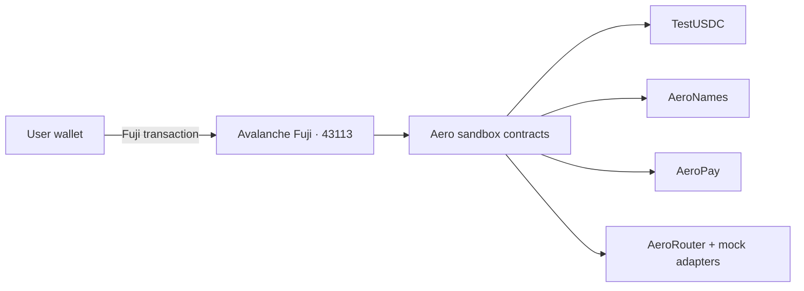
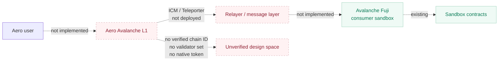
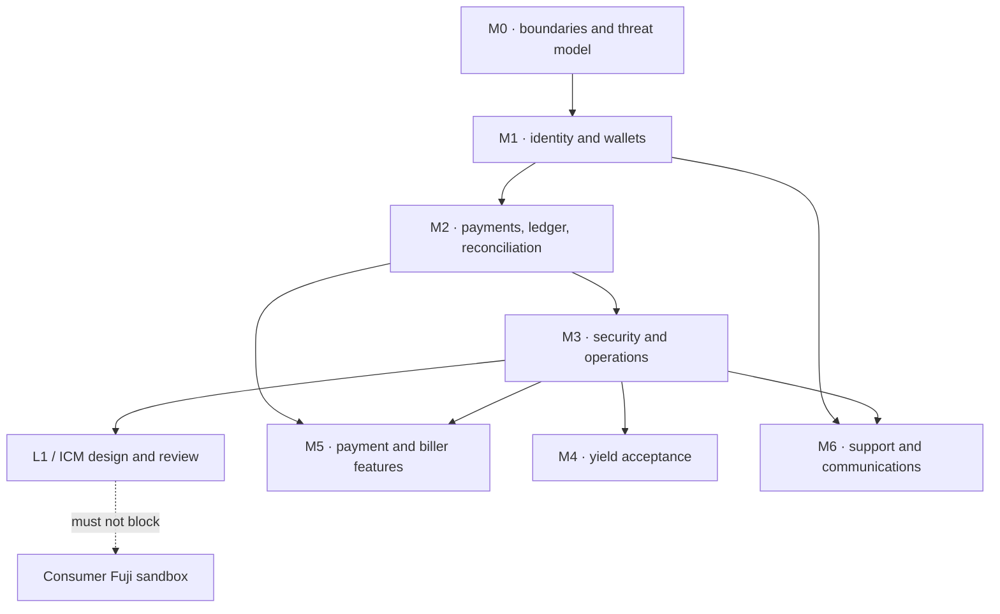

## A separate workstream

Aero L1 is an Avalanche L1 / ICM direction. It is **not** part of the consumer Fuji sandbox. The repository does not establish a verified Aero L1 chain ID, validator set, native token, bridge, Teleporter deployment or consumer cross-chain payment flow.

{{badge:Design}} A separate workstream. {{badge:Blocked}} No consumer integration. {{badge:Not supported}} No cross-chain payment path today.

This page exists to draw the boundary clearly, not to imply a launch.

## Current consumer architecture

The consumer app is Fuji-only. It connects a wallet to Fuji `43113`, reads Fuji contracts, and submits wallet-signed Fuji transactions. There is no second chain in the payment path, no relayer in the transfer path and no message-passing dependency.

That is the entire consumer flow. It does not cross a chain boundary.

## Conceptual L1 / ICM direction

ICM (Interchain Messaging) is Avalanche's native cross-chain messaging primitive, often used with Teleporter. A future Aero L1 could host application-specific logic and exchange messages with Fuji or another chain. That sentence is a direction, not an implementation.

The dashed path is intentionally not a claim. No consumer flow depends on it.

## What is and is not established

| Item | Status | Evidence |
|---|---|---|
| Fuji consumer network | {{badge:Implemented}} {{badge:Fuji}} | Chain ID `43113`, configured RPC and contracts. |
| Aero L1 chain ID | {{badge:Verification}} | No verified tracked value. |
| Validator set | {{badge:Not supported}} | No tracked validator configuration or operational record. |
| Native token | {{badge:Not supported}} | No token contract, genesis allocation or issuance model established. |
| Teleporter / ICM contracts | {{badge:Not supported}} | No tracked deployment or consumer integration. |
| Relayer operation | {{badge:Blocked}} | No verified production relayer service, monitoring or key custody. |
| Cross-chain payment | {{badge:Not supported}} | No user-facing bridge or cross-chain transfer. |
| L1 security model | {{badge:Blocked}} | No reviewed validator, bridge, replay, finality or recovery model. |

A local Avalanche CLI relayer configuration in the working tree is not a deployment record and is not evidence of a live L1. It must not be treated as trusted chain metadata.

## Why not integrate it now

Cross-chain messaging adds failure modes that the consumer product is not ready to absorb:

- message replay and domain separation;
- relayer liveness and censorship;
- source-chain finality and reorg handling;
- destination-chain execution failure and retry state;
- validator-set and bridge trust assumptions;
- key custody and incident response;
- a second token/asset accounting model;
- recovery when a message is delivered but execution fails.

The current payment system does not yet have a durable internal ledger or finality policy for a single chain. Adding a second chain before that would multiply uncertainty.

## Dependency order

Aero L1 work is intentionally downstream of the foundational milestones:

The consumer product does not need to wait for Aero L1. Conversely, L1 messaging should not be sold as a consumer feature before a reviewed design, an operational relayer and a verified chain exist.

## What would count as progress

- A reviewed architecture with chain ID, genesis, validator model, native token policy and upgrade authority.
- A reproducible deployment record and independent verification.
- A tested ICM/Teleporter path with replay, finality, failure and recovery cases.
- A relayer runbook, monitoring, key custody and incident process.
- A product use case that is valuable enough to justify the added trust boundary.
- An explicit decision-register approval (D-14) separating L1 from consumer scope.

Until then, the honest label is **design / unverified**, not “Aero chain” or “cross-chain payments.”
