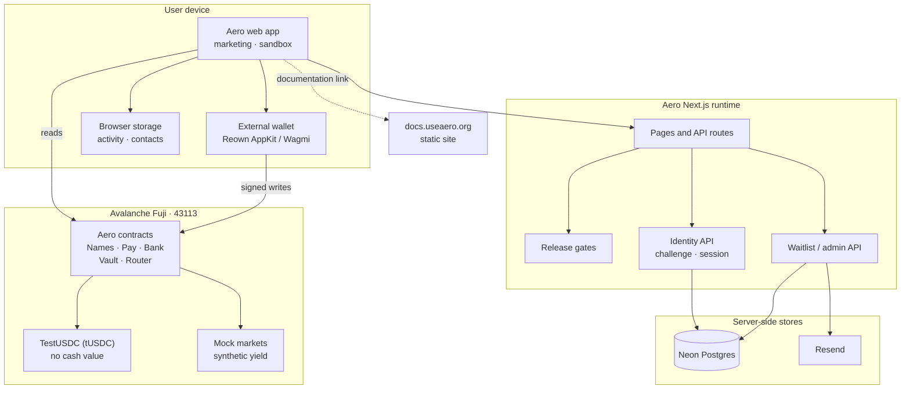
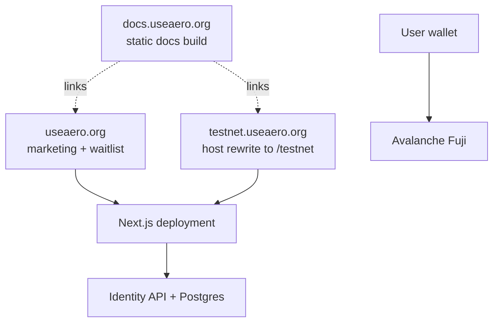

## One application, several trust boundaries

Aero is a single Next.js application that serves marketing, a Fuji wallet sandbox and a small identity API. The contracts live on Avalanche Fuji. The documentation site is a separate static application deployed at `https://docs.useaero.org`.

The important architectural fact is that **the browser talks to contracts through the user's wallet**. There is no Aero transaction-signing service, no custodial key and no server-side transfer authorization. The identity API adds accounts and sessions, but those sessions never authorize a token transfer.

## High-level architecture

The diagram shows code paths, not production integrations. The markets behind the adapters are mock contracts in the supplied deployment. The identity database is implemented in source and migrations but has not been applied to Neon in the recorded milestone.

## Components

### Marketing and waitlist

`app/page.tsx` renders the public landing page. The waitlist API accepts an email and preferred username, sends a confirmation through Resend, and stores the record in Neon when `DATABASE_URL` exists, otherwise in a local JSONL file. The waitlist is not an account and does not reserve an on-chain handle.

### Fuji sandbox

`/testnet` is the wallet-connected application. Middleware rewrites requests on `testnet.useaero.org` to the `/testnet` route. The sandbox reads Fuji through a public RPC, asks the connected wallet to sign writes, and stores presentation state such as recent activity, contacts and seen notices in browser storage.

### Identity API

The identity API is under `app/api/identity/`. It implements Fuji EOA SIWE challenges, verification, server-side sessions, wallet linking, reauthentication, primary switching and revocation. It uses a dedicated runtime database URL and a least-privilege database role. Account creation is closed.

### Contracts

The contract set separates concerns:

| Contract | Role |
|---|---|
| `TestUSDC` | Six-decimal test token with a 24-hour faucet. No cash value. |
| `AeroNames` | On-chain handle registry with one active handle per address. |
| `AeroPay` | Memo-bearing token payment with optional username resolution. |
| `AeroBank` | Sandbox inventory used by the simulated card checkout. Owner can sweep test inventory. |
| `AeroVault` | Synthetic-rate yield demo. No external market. |
| `AeroRouter` | Share-accounted portfolio over exclusive adapters. Mock markets in the integrated script. |
| `BenqiAdapter` | QiToken-style adapter bound one-to-one to a router. |
| `MockQiToken` | Owner-rate-controlled mock market used by the deployment script. |

## Request and data flow

A Send transaction follows this path:

1. The browser reads the recipient handle from AeroNames, or validates a raw address.
2. The user signs an approval and then a payment transaction in the wallet.
3. The wallet submits to Fuji. Aero does not see or hold the private key.
4. AeroPay calls `transferFrom`, emits `Paid` with a memo and timestamp, or the token's `transfer` is called directly.
5. Wagmi waits for a receipt. The browser shows the hash and may write a local activity entry.
6. The durable evidence is the Fuji transaction and contract event. There is no internal ledger or reconciliation service.

An identity request is different: it goes to the Aero server, is rate-limited and origin-checked, and uses the identity database. It proves wallet ownership for account purposes. It does not sign or submit a transfer.

## Deployment shape

The docs domain is intentionally independent. It can be built and deployed without rebuilding the main Next.js app, and a docs outage does not take down the sandbox. DNS and hosting changes are deployment operations outside this repository; see [Deployment and operations](/operations/).

## Trust boundaries

| Boundary | What crosses it | What does not |
|---|---|---|
| Browser to wallet | Transaction intent and user approval | Aero never receives the private key. |
| Browser to Fuji RPC | Reads and submitted signed transactions | The server does not co-sign. |
| Browser to Aero API | Identity challenges, sessions, waitlist data | API sessions cannot move tokens. |
| Aero server to database | Identity records and rate-limit state | No consumer payment ledger exists. |
| Aero server to Resend | Waitlist email content | No financial instruction or secret. |
| Router to adapters | Deposits, withdrawals, share conversions | Adapters are router-exclusive after binding. |
| Adapters to markets | QiToken-style supply/withdraw | Supplied markets are mocks, not live Benqi/Joe. |

The [Security and engineering](/security/) page expands the threat model. [Identity and accounts](/identity/) explains why a wallet connection is not authentication.
