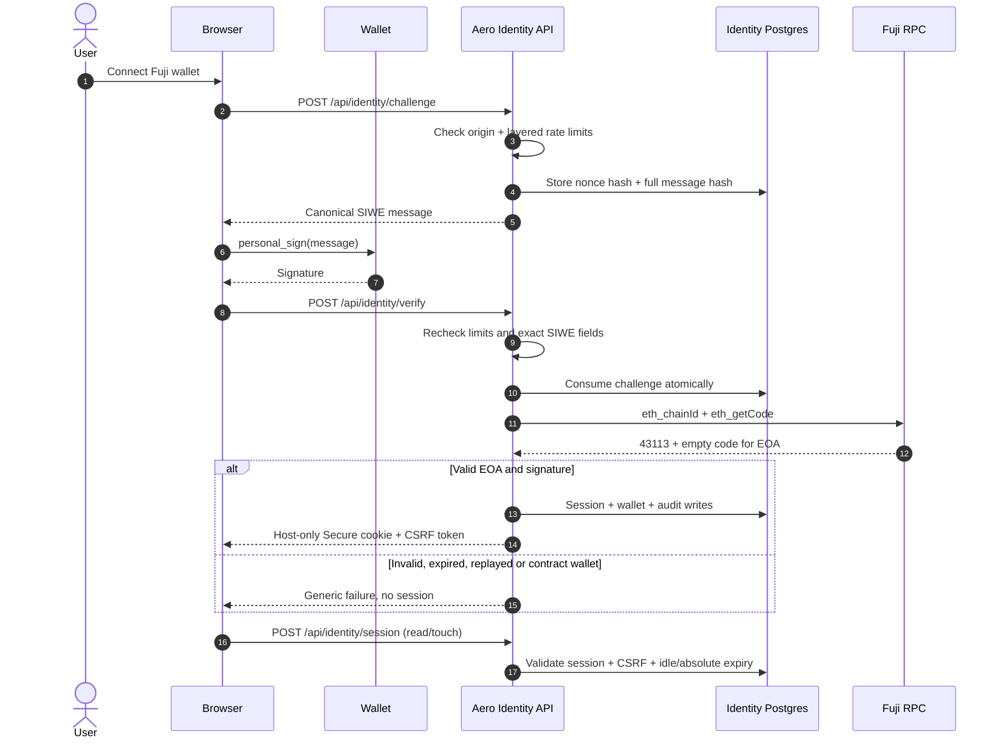

## Identity is not wallet connection

The sandbox can be used by connecting a wallet, but that only establishes an address in the browser. Aero's identity layer is a separate, server-verified account model: one internal Aero account can be linked to multiple independently verified wallets. It is implemented for **Fuji EOA only**, and **account creation is closed**.

{{badge:Implemented}} Source and migrations exist. {{badge:Tested}} The server flow passed against a disposable PostgreSQL database. {{badge:Blocked}} No Neon migration or role provisioning has been applied, so the current deployment cannot create or authenticate accounts.

> A wallet connection is a convenience. An Aero session is an account authentication. Neither one is authority to move tokens.

## Wallet authentication flow



The server chooses the domain, URI, statement, chain ID, issue time, expiry, request ID and 256-bit nonce. The client cannot override them. The signed message says the proof cannot authorize transfers.

## What the implementation enforces

| Control | Behavior |
|---|---|
| Network | Fuji `43113` only. A wrong chain is rejected. |
| Wallet kind | EOA only. `eth_getCode` must return empty code; contract wallets/EIP-1271 are not supported for M1B. |
| Signature | EIP-191 `personal_sign` over the exact canonical SIWE message. |
| Challenge storage | Nonce hash and full-message hash are stored, not the raw bearer material. |
| Replay | Challenge is consumed once in the same transaction that writes the session/wallet state. |
| Origin | Exact configured canonical origin. |
| Cookies | Host-only, `Secure`, `HttpOnly`, `SameSite` session cookie. |
| CSRF | Session-bound CSRF cookie/header pair required on unsafe methods. |
| Expiry | Default 12-hour idle and 7-day absolute session; absolute cap 30 days. |
| Rotation | Session tokens rotate on the dedicated rotate endpoint. |
| Logout | Current session and logout-others are supported. |
| Rate limits | Layered IP, global, and per-user limits stored in Postgres. Limiter failure returns `503`, not a bypass. |
| Audit | Append-only identity audit rows with a truncate guard. |
| Runtime database | Dedicated least-privilege role; no DDL, no `DELETE`, no direct rate-limit table access. |
| Account creation | Closed. `create_account` has no issuance or verification route. |

## Wallet lifecycle

1. The first wallet in any future approved bootstrap must be primary.
2. A second wallet can be linked only with a fresh proof from that wallet and recent reauthentication from an existing linked wallet.
3. A linked wallet starts non-primary.
4. Primary switching requires fresh proof from the new primary.
5. Revoking a primary promotes the earliest remaining active wallet.
6. Revoking the last active wallet is rejected.
7. Revoking a wallet revokes sessions tied to that wallet's authentication or reauthentication.
8. A handle remains bound to its AeroNames recipient wallet. Other linked wallets are not equivalent payment destinations.

There is **no assisted recovery**. Multiple wallets provide continuity only if at least one remains accessible. Aero support cannot override key proof.

## Closed signup and retention

Two decisions deliberately constrain the live surface:

- **D-24 — account creation closed.** Login resolves existing accounts only. The identity table is empty unless a separately approved enrollment process is later run.
- **D-12 — retention unresolved.** No retention interval is approved. There is no purge job, hard-delete API or enabled account closure. `AERO_IDENTITY_RETENTION_POLICY_APPROVED` remains false, and destructive retention functions throw until a policy is configured.

This means identity data can accumulate if endpoints are enabled without a retention policy. That is a known operational gap, not a resolved feature.

## Configuration

The runtime and migration credentials are separate:

```bash
# Runtime
AERO_IDENTITY_DATABASE_URL=
AERO_AUTH_ORIGIN=https://testnet.useaero.org
AERO_FUJI_RPC_URL=https://api.avax-test.network/ext/bc/C/rpc
AERO_SESSION_SECRET=            # at least 32 random bytes
AERO_TRUST_PROXY=none           # or vercel / header:<name>
AERO_IDENTITY_POOL_MAX=5
AERO_SESSION_IDLE_SECONDS=43200
AERO_SESSION_ABSOLUTE_SECONDS=604800
AERO_IDENTITY_RETENTION_POLICY_APPROVED=false

# Provisioning only, never in the running app
AERO_IDENTITY_ADMIN_DATABASE_URL=
AERO_IDENTITY_RUNTIME_ROLE=aero_identity_runtime
AERO_IDENTITY_RUNTIME_PASSWORD=
```

The preferred migration URL is `AERO_IDENTITY_MIGRATION_DATABASE_URL`, falling back to the documented owner URL. The runtime must never use the owner/migration role.

## What identity does not do

- It does not create an account from a wallet connection.
- It does not authorize a payment, approval, deposit or withdrawal.
- It does not replace AeroNames as the handle authority.
- It does not support contract wallets or EIP-1271 in M1B.
- It does not provide recovery if every linked wallet is lost.
- It does not provide a browser-verified two-wallet flow yet. The server-side flow passed; the wallet prompt experience still needs manual E2E.

Read the [security page](/security/) for controls and gaps, and [Developer guide](/developers/) for the migration runbook.
