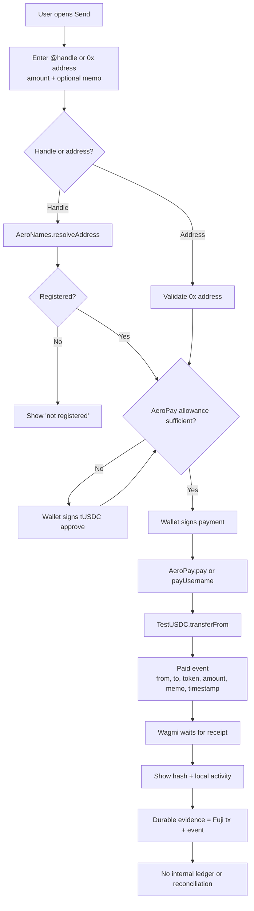

## Three payment-shaped surfaces

The sandbox has a single token movement primitive — a wallet-signed Fuji transfer — wrapped in several product experiences. Keeping those wrappers distinct avoids overstating what is connected.

| Surface | Primitive | What is not there |
|---|---|---|
| Send | AeroPay `pay` / `payUsername`, or token `transfer` | No durable payment record or reversal. |
| Request | A share link with an optional amount | No receivable, escrow or request ledger. |
| Bill presets | Prefilled Send form | No biller API, account validation, quote or fulfillment. |
| Card checkout | Simulated card step + AeroBank token transfer | No card processor, fiat charge or banking service. |

## Payment flow



A successful hash is **submission evidence**, not proof of finality. The UI waits for a receipt, but Aero has no chain-specific finality policy, reorg reconciliation or payment state machine.

{{widget:lifecycle-stepper}}

## AeroPay

`AeroPay.sol` is intentionally small:

```solidity
function pay(address token, address to, uint256 amount, string calldata memo) external {
    require(to != address(0), "BAD_TO");
    require(bytes(memo).length <= MAX_MEMO_BYTES, "MEMO_TOO_LONG");
    IERC20(token).safeTransferFrom(msg.sender, to, amount);
    emit Paid(msg.sender, to, token, amount, memo, block.timestamp);
}
```

`payUsername` resolves a handle through an `IAeroNames` registry and then performs the same transfer. The memo limit is 140 bytes. The contract emits `Paid` with the sender, recipient, token, amount, memo and timestamp.

{{widget:memo-inspector}}

### Known limitations

- The contract accepts a caller-supplied token address. It does not enforce a token allowlist.
- It does not reject a zero amount. The UI rejects non-positive input, but the contract itself does not.
- The UI currently uses an **unlimited tUSDC approval** to AeroPay. That is a sandbox convenience and a production gap; allowance/revoke UX is planned.
- The direct-transfer fallback does not emit the `Paid` memo event.
- There is no payment intent, idempotency key, retry worker, confirmation webhook, refund or dispute function.
- The recipient's identity is not asserted beyond the handle's on-chain registration.

## Request links

A request is a URL, not an on-chain request. A user with a handle can generate:

```text
https://useaero.org/pay/@handle
https://useaero.org/pay/@handle/25
```

The link opens the public pay page with the recipient and optional amount prefilled. It does not reserve funds, create an invoice, enforce expiry or notify the payer. The request is only as reliable as the handle and the payer's willingness to send.

## Bill presets

The Pay screen includes three static presets:

| Preset | Prefilled memo | Recipient |
|---|---|---|
| Maple Apartments | Rent · Maple Apartments | Empty; the user must select a recipient |
| City Power & Light | City Power & Light | Empty |
| @lena · invoice #042 | Invoice #042 | `@lena` |

Each preset fills the normal Send form. The page explicitly says: “These shortcuts prefill a normal tUSDC transfer; no biller is connected.”

There is no biller API, account-number validation, quote, fee, fulfillment status, receipt, reversal, retry/idempotency policy or support escalation. This is a UI prototype for a future provider adapter, not a bill-payment service.

## Simulated card checkout

The Buy sheet offers test packs. The flow is:

1. The user chooses a test amount and enters card-shaped test details.
2. The UI simulates the card step.
3. A wallet-signed Fuji transaction transfers pre-funded tUSDC from `AeroBank` to the user.

No card processor is contacted, no fiat is charged, no KYC/AML check occurs and no banking relationship exists. `AeroBank` is an owner-controlled sandbox inventory contract. The only on-chain settlement is the test-token transfer.

## Payment history

The current history is not a statement. It combines:

- bounded recent on-chain reads, focused on token transfers and some vault events;
- browser-local activity entries written after a successful receipt;
- locally stored contacts and notification state.

Router events are not fully indexed. A browser reload, a different device or a pruned RPC window can change what is displayed. There is no double-entry ledger, immutable journal or reconciliation job.

## What production payments require

Before a real payment product, Aero needs at minimum:

- a durable payment intent and transaction state machine;
- chain-specific finality and reorg handling;
- idempotency for client retries and duplicate events;
- an event indexer with reconciliation and dead-letter visibility;
- a token allowlist and approval/revoke UX;
- authenticated provider responses for any biller or card flow;
- refunds, reversals and support escalation;
- an account model that links a payment to an internal user without treating a session as transfer authority.

The [roadmap](/roadmap/) sequences this work in Milestones 2–5. The current release gate blocks beta and production until the foundational pieces exist.
