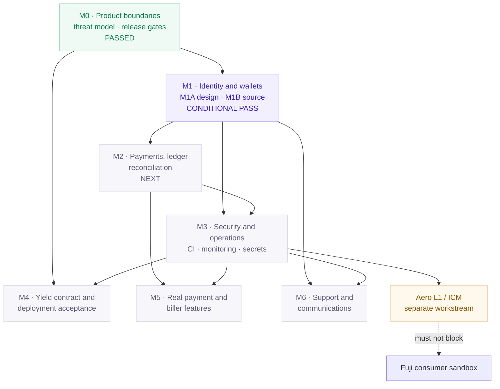

## The dependency map

The roadmap is ordered on purpose. Payments, identity and security come before provider integrations and real yield. Aero L1 is downstream and separate.

## Current milestone status

| Milestone | Status | What exists |
|---|---|---|
| M0 | {{badge:Implemented}} {{badge:Tested}} | Product boundaries, threat model, release gates, decisions register. Beta/production intentionally blocked. |
| M1A | {{badge:Implemented}} | Identity, wallet, recovery and session architecture. Documentation only. |
| M1B | {{badge:Implemented}} {{badge:Partial}} | Fuji EOA SIWE, linked wallets, sessions, rate limits, audit, runtime role, UI panel. Conditional pass. |
| M1C | {{badge:Planned}} | Field-level retention/deletion, browser two-wallet E2E, Neon role provisioning, controlled enrollment decision. |
| M2 | {{badge:Planned}} | Durable payment intent/state, ledger, idempotency, indexer and reconciliation. |
| M3 | {{badge:Planned}} | Managed staff identity, CI, monitoring, alerting, secret management, incident and backup drills. |
| M4 | {{badge:Partial}} | Router source and adversarial tests exist. B2.2 simulation ready for approval; no broadcast, no live market, no audit. |
| M5 | {{badge:Planned}} | Real payment request/receipt and biller/provider adapter. |
| M6 | {{badge:Planned}} | Support tickets, communications and account operations. |
| Aero L1 | {{badge:Design}} {{badge:Blocked}} | Separate workstream. No verified chain identity, validator set, native token or consumer ICM flow. |

## Where the last milestone ended

### M1B — conditional pass

M1B implemented and tested the server-side identity foundation. The closure was **CONDITIONAL PASS**, not a full pass. Open items:

- browser two-wallet E2E with real providers and funded Fuji EOAs;
- Neon/production role provisioning and migration;
- production-representative pool/limiter load testing;
- retention decision D-12;
- explicit enrollment policy.

Account creation remains closed. No user was created in Neon.

### B2.2 — ready for approval, not deployed

The B2.2 report simulated a fresh nine-transaction router stack:

- two mock markets;
- two adapters;
- one router with 60/40 targets;
- two adapter bindings;
- AeroPay;
- AeroBank.

No transaction was broadcast. Predicted addresses are untrusted. The trusted manifest is empty. The verdict is **READY FOR EXPLICIT BROADCAST APPROVAL**, subject to a separate authorization.

## What comes next

### 1. M1C — close identity operations

- Resolve D-12 with field-level retention and deletion rules.
- Run the browser two-wallet E2E.
- Provision Neon roles and apply migrations with an approved maintenance window.
- Decide whether a controlled Fuji enrollment is justified.
- Keep signup closed until that decision.

### 2. M2 — build the financial record

- Payment intent and immutable transaction state machine.
- Idempotency keys and `(chainId, txHash, logIndex)` uniqueness.
- Reorg-aware indexer and reconciliation job.
- Confirmation/finality policy.
- Allowance/revoke UX and token allowlist.
- Support for failed, replaced, reverted and reorged transactions.

### 3. M3 — make operations real

- Managed staff identity and role-based authorization.
- CI for lint, typecheck, build, migrations, contract tests and browser tests.
- Structured redacted logs, metrics, alerting and incident runbook.
- Secret manager, rotation and canonical-origin policy.
- Backup/restore and rollback drills.

### 4. M4 — accept yield only after review

- Freeze source and build inputs.
- Run the full Foundry and adversarial/property suites from a clean environment.
- Resolve the remaining adapter withdrawal share-delta question.
- Test against a pinned live-market fork.
- Decide the withdrawal liquidity model (queue, reserve or reviewed all-or-nothing).
- Add pause/emergency controls, timelock/multisig ownership and monitoring.
- Produce a signed deployment manifest and independent runtime verification.

### 5. M5–M6 — provider features and support

Only after M1–M3:

- biller/provider adapter with authenticated responses, quotes, reversals and idempotency;
- real payment request/receipt screens over the durable record;
- fiat on-ramp only through an approved provider with KYC/AML and jurisdictional controls;
- support ticket, message, assignment and audit model;
- notification preferences and delivery status.

## What is deliberately not next

- A new consumer surface before the ledger.
- Live Benqi/Joe yield before audit and liquidity acceptance.
- A production token or chain before an approved manifest.
- Aero L1/ICM as a consumer feature.
- Real-money biller/card flows before legal, provider and support readiness.
- A marketing claim that outruns the release gate.

## Decision gates

The [decisions register](https://github.com/danielamodu/Aero/blob/main/AERO_DECISIONS_REGISTER.md) records unresolved decisions D-05 through D-20, including production chain, assets, finality, yield risk, withdrawal expectations, billers, retention, support access and deployment ownership. A milestone cannot close by declaring a decision resolved in code alone.

See [Current status](/status/) for the evidence matrix and [Security](/security/) for the open risks.
