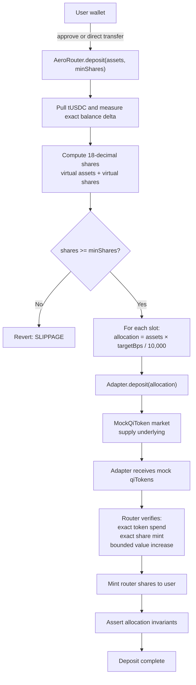
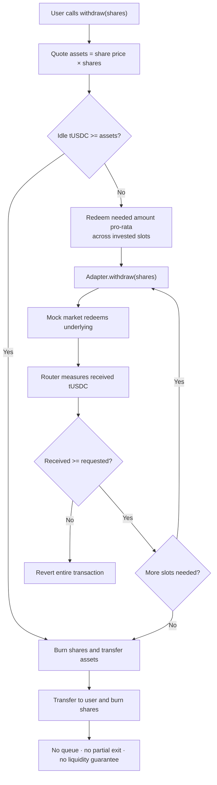
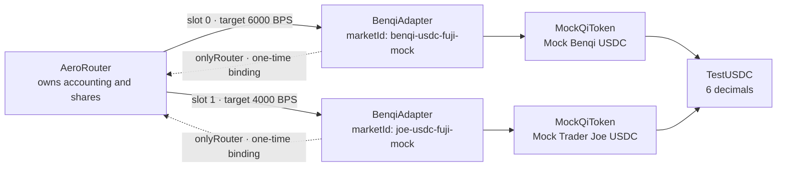

## Two yield paths, no live yield

Aero has two separate implementations. They are easy to confuse, so the boundary is stated first:

| Path | Status | Truth |
|---|---|---|
| `AeroVault` | {{badge:Mock}} | A synthetic rate/index demo, funded by finite test-token inventory. It does not touch a lending market. |
| `AeroRouter` | {{badge:Implemented}} {{badge:Mock}} | Real share accounting over adapter wrappers. The supplied integrated deployment uses `MockQiToken` markets, not live Benqi or Trader Joe. |

Neither path is a live yield product. No independent audit, live-market acceptance, liquidity guarantee or production asset exists.

## AeroVault: the simple mock

AeroVault is an ERC-4626-shaped demo. Its owner sets `ratePerSecond`; `accrue()` grows the share index mathematically. There is no external protocol, no market and no real revenue. The deployment script seeds the vault with test tokens so withdrawals can cover some accrual, but accrual can outrun that finite inventory.

This path exists to test deposit, share and withdrawal UX. It must not be described as yield from Benqi, Trader Joe or any other market.

## AeroRouter: the portfolio implementation

AeroRouter is a share-accounted portfolio. It:

- holds six-decimal underlying assets (tUSDC in the sandbox);
- values idle assets plus **only the adapter shares it owns**;
- uses virtual assets/shares to blunt first-depositor inflation;
- accepts `minShares` on deposit to bound slippage;
- supports owner-set static targets summing to exactly `10,000` BPS;
- binds each adapter to the router one time;
- withdrawals idle first, then redeem pro-rata across invested slots;
- reverts the whole withdrawal if a required adapter fails or returns short.

The router's deployment version is `2_111`. The frontend checks that version plus Fuji bytecode, asset equality, slot count and `configurationValid()` before enabling router actions. That is a configuration gate, not a source-verification or audit.

### Deposit and allocation

The router does not trust an adapter's self-report alone. It measures the token balance change, checks the increase in adapter shares held by the router, compares that to the adapter-reported mint, and requires a bounded value increase. A failing adapter reverts the deposit.

### Withdrawal

Withdrawal is **all-or-nothing**. If one required adapter cannot redeem enough, the entire transaction reverts and the user's shares remain intact. This avoids silently burning shares on a failed exit, but it does not guarantee timely liquidity. There is no reserve, queue, partial withdrawal or asynchronous claim.

### Adapter and router relationship

Both adapters use the same `BenqiAdapter` implementation. The “Joe” market is a second mock QiToken, not a Trader Joe-specific adapter. There is no Trader Joe integration contract in the repository.

The adapter is router-exclusive after `setRouter`. It accepts deposits and withdrawals only from its bound router. The router values `sharesOf(router)`, not the adapter's total market balance, so assets held by other accounts are excluded.

## Allocation is static, not optimized

`rebalance()` moves funds toward the owner-set target weights. It does **not** compare APYs, select the best market or run automatically. There is no keeper, no automatic rebalancing service and no optimizer.

The integrated script configures a 60/40 split. The displayed APY is a weighted annualization of the mock market's reported supply rate; idle assets contribute zero. The rate is owner-controlled in the mock market. It is not a return promise.

## Risk and limitations

- **No live-market verification.** The adapter source wraps a QiToken-like interface, but no current live Benqi market was integrated or fork-tested in the recorded milestone.
- **Mock rates.** The APY displayed is derived from mock contracts.
- **Illiquidity.** A withdrawal can revert if any required adapter cannot redeem. There is no queue or reserve.
- **Owner trust.** The owner sets targets, can add/remove adapters under invariants, and controls mock rates. Ownership is a direct `Ownable`; no multisig, timelock or pause exists in the router source.
- **Adapter trust.** The router checks share minting and measured token deltas, but a malicious or broken adapter with unusual conversion semantics remains a risk. Future adapters require a strict interface and adversarial tests.
- **No independent audit.** Tests and source review exist; they are not an audit.
- **Frontend gate limits.** `configurationValid()` and `deploymentVersion` can be satisfied by any contract that returns the expected values. They are not bytecode provenance.
- **No trusted manifest.** `lib/fuji-router-manifest.ts` remains intentionally empty. B2.2 predicted addresses were not written to it.

## Deployment status

B2.2 simulated a fresh nine-transaction mock stack with no broadcast. The report verdict was **READY FOR EXPLICIT BROADCAST APPROVAL**, not “deployed.” The current frontend router manifest is empty. Historical addresses must not be treated as the current deployment.

Before any real-value deposit, the roadmap requires independent review, live-market/fork validation, a withdrawal liquidity decision, pause/emergency controls, ownership review, verified deployment manifest and monitoring. See [Roadmap](/roadmap/) and [Security](/security/).
